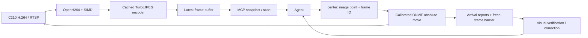
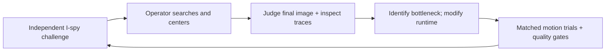

# Optimizing an agent's camera with “I spy”

We connected a Tapo C210 to a coding agent through MCP, then used object-search
tasks to improve the camera runtime. The workload exercised the complete loop:
observe, select a target, move, and verify the resulting image.

## Architecture: persistent video, bounded control

The original Python path reopened RTSP for each snapshot: approximately **2.5 s**
per stationary capture. The Rust runtime maintains a persistent H.264 connection,
decodes the minor stream at **640 × 360 / 15 fps**, and overwrites a latest-frame
buffer. Warm MCP previews take approximately **2 ms**. These measure different
capture architectures, not an isolated Python-versus-Rust language benchmark.

One centering call handles calibrated motion and bounded visual corrections.
Batched scans reduce agent round trips. Tracked operations require two arrival
reports, **15 ms polling**, and **50 ms settling**, followed by a newly received
frame. Rough aiming skips extra settling and visual correction.

## Recursive improvement through independent challenges

A second agent operated another camera, selected room objects, and withheld its
coordinates and evidence until adjudication. A pass required a recognizable,
unsmeared target within normalized radius **0.08** of the image center.

The coding agent could improve the implementation behind its own tools. Repeated
same-origin movements separated runtime gains from learning the room; fresh
held-out targets checked end-to-end usefulness.

## Results and rejected optimizations

| Matched move-plus-image measurement | Baseline | Final |
| --- | ---: | ---: |
| Median | 933.0 ms | 613.8 ms |
| p95 | 1,239.0 ms | 911.1 ms |
| Optical geometry passes | 18/18 | 18/18 |

Median latency improved **34%**. Blocks ran baseline then candidate, rather than
interleaved. Three independent held-out targets passed their first submitted
final frame; those search tasks were not matched speed comparisons.

Tracing covered ONVIF requests, polling, settling, frame waits, codecs, tracking,
and MCP output. We rejected zero-wait variants that blurred images or broke scan
revisits, explicit maximum-speed commands that stalled, and continuous motion
that overshot. Position feedback alone did not establish optical stability.

Agent latency remained substantial: one headphones challenge used **919 ms of
camera calls**, but **51 s** from delivery to verdict. Tool latency, physical
motion, stream cadence, and agent coordination require separate measurements.

The resulting plateau applies to this firmware, LAN, and workload. The useful
recursive loop was **tool use → evidence → code change → independent validation**.

Source measurements: [I-spy experiment log](../../benchmarks/i-spy/README.md).
Implementation and tracing: [runtime documentation](../../README.md).
