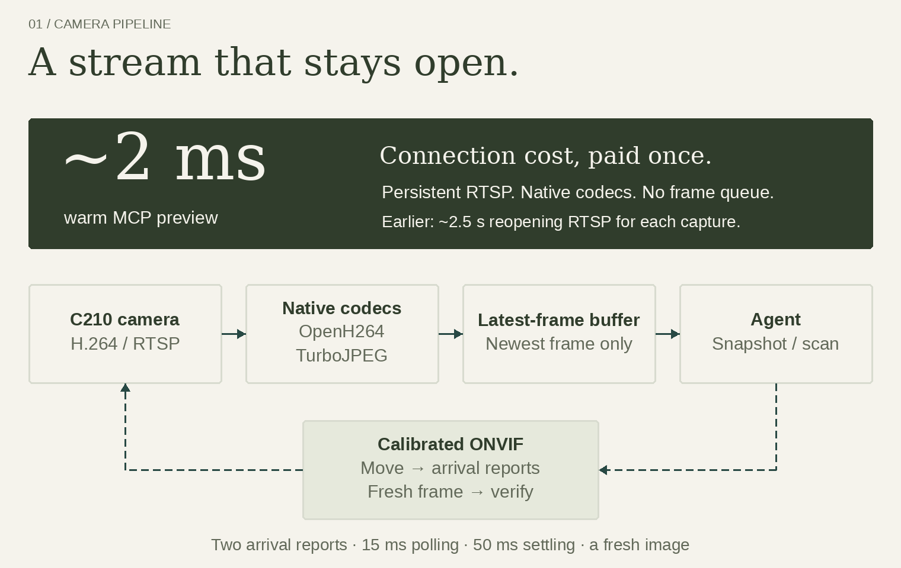

# I spy: a recursive self-improvement loop

I gave a coding agent a Tapo C210 and asked it to find things in my office.
It could see and move, but finding the printer meant a slow sequence of snapshots,
motor commands, waits, and corrections. The agent also had access to the source
of its camera tools. That made a useful experiment possible: could using those
tools generate the evidence needed to improve them?

We turned “I spy” into a **recursive self-improvement (RSI) loop**. A second agent,
using another camera, chose objects and withheld their coordinates. The operator
searched and centered each target; the challenger judged the final image.
Failures and timing traces informed changes to the runtime, which the operator
then used for the next round. The recursion ran through the agent's tools:
**observe → measure → rewrite → validate → observe again**.

The first win came from video ingestion. The original Python path reopened RTSP
for each snapshot, taking about **2.5 seconds**. We built a native Rust runtime
with persistent H.264 ingestion, accelerated OpenH264, a cached TurboJPEG encoder,
and a latest-frame buffer. Warm MCP previews reached approximately **2 ms**.
Keeping the connection open drove the improvement; the measurements compare
capture architectures rather than isolating programming-language speed.

Next, we moved control work behind the tool boundary. One image-point centering
call handled calibration, ONVIF motion, fresh-frame acquisition, and bounded
visual correction. Batched scans reduced reasoning round trips. Traces separated
network requests, position polling, settling, video waits, and image processing.

The loop also rejected seductive regressions. Maximum-speed commands stalled;
continuous motion overshot. Removing waits produced blurred frames or broke scan
revisits. The accepted controller used two arrival reports, 15 ms polling, 50 ms
settling, and a fresh-frame barrier.

In two same-origin, 18-trial blocks, median movement-plus-image time fell from
**933 to 614 ms: 34% faster**, with 18/18 optical geometry passes in both blocks.
The blocks ran baseline then candidate. Fresh held-out targets checked usefulness;
matched movements kept learning the room from counting as faster software.

One challenge still took **51 seconds** despite using only **919 ms of camera
calls**. Reasoning and coordination remained expensive. That exposed the next
optimization target: the agent's interaction loop itself.

The useful property of this RSI experiment was its external feedback. The agent
could change its tools, but independent challenges and repeatable measurements
had to establish that the new version was better.

[Experiment records](../../benchmarks/i-spy/README.md) ·
[Runtime and instrumentation](../../README.md) ·
[Diagram skill and branding kit](https://github.com/Belval/skills/tree/main/diagram-making)
