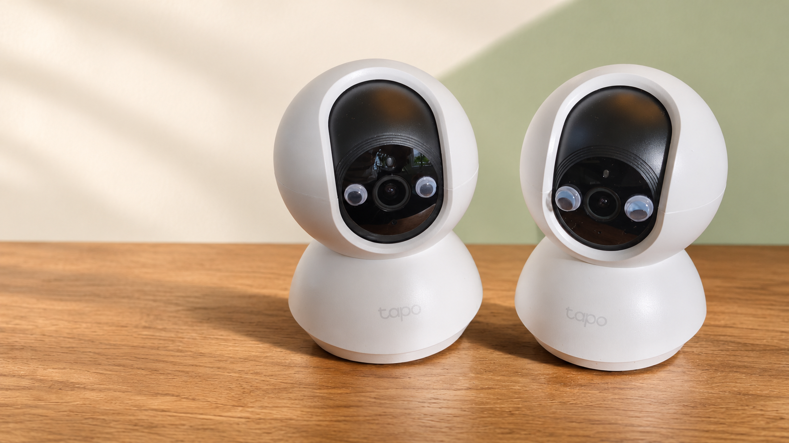
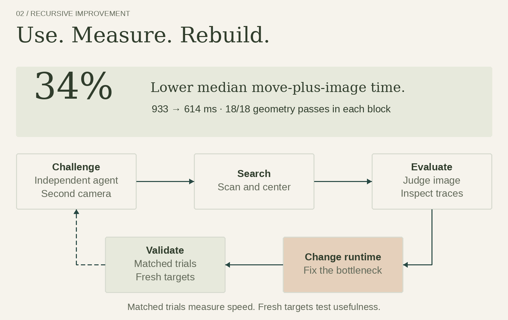

# Peek, Seek, and recursive self-improvement

*From a Python ONVIF reader to a native Rust camera pipeline, guided by a game of I spy.*

I asked a coding agent to find the printer in my office. It found it, slowly:
snapshot, move, wait, correct. The agent could edit its camera tools, so each
awkward interaction was also evidence for what to improve.

Meet **Peek and Seek**, two roughly $25 Tapos. Peek's agent chooses an object and
withholds its coordinates; Seek's agent searches. The googly eyes made the whole
business of AI-controlled cameras looking around my room feel less off-putting.

## Rewrite the architecture, then optimize the runtime

The Python path reopened RTSP for every snapshot, costing about **2.5 seconds**.
We moved ONVIF, video ingestion, MCP and tracking into Rust. A persistent stream
published only the newest frame, shared through `Arc`, instead of reopening the
connection or accumulating an image queue. Warm previews reached approximately
**2 ms**. The camera still supplies 15 fps; this is buffered retrieval time.
The architecture changed along with the language.

Then we worked on the Rust pipeline: keep codec work off Tokio's I/O workers,
avoid leaving detail streams running, and open connections only when used.
Tracing exposed reconnect stalls. Frame-local JPEG recovery helped, and switching
the preview to H.264 removed the observed multi-second capture stalls.

The image path gained a reusable TurboJPEG compressor and SIMD resizing. One
particularly useful discovery: installing NASM had not accelerated a previously
cached OpenH264 build. We cleaned and rebuilt that release dependency, then
verified the assembly symbols in the resulting archive.

## Eleven engineering checkpoints, ten commits

These are the code and build changes, not repeated timing trials. Times below
are commit times on **28 October 2026 (UTC)**; not every checkpoint has an isolated
speedup measurement.

Read the 11 commit-linked engineering checkpoints

| UTC | Engineering checkpoint | Commit |
| --- | --- | --- |
| 00:45 | **Smaller Python previews**. Return 640 px previews; request full detail only when needed. | [d3eeaa7](https://github.com/Belval/onvif-mcp/commit/d3eeaa7d4cbc5e0edad00b7fed87ee31ad1352e8) |
| 01:00 | **Native Rust ingestion**. Implement ONVIF and persistent RTSP with a latest-frame buffer. | [4eeaf12](https://github.com/Belval/onvif-mcp/commit/4eeaf12cdf52e195d7a993288b3d37cbb6ae0b41) |
| 01:22 | **Complete the Rust tool path**. Port MCP, visual tracking, native JPEG assembly and background pose polling. | [aab1795](https://github.com/Belval/onvif-mcp/commit/aab1795007f4cda627f2aea488016039f08455e5) |
| 01:41 | **Keep I/O nonblocking**. Move codec work onto blocking workers; isolate short-lived detail streams. | [c21420b](https://github.com/Belval/onvif-mcp/commit/c21420b48dca1022d7e2597e64b07331add04030) |
| 01:50 | **Connect only on demand**. Lazily initialize camera connections and retire the Python runtime. | [5c4ce20](https://github.com/Belval/onvif-mcp/commit/5c4ce20ce3979367c26c8514d578b06bba7c3058) |
| 02:43 | **Instrument the whole path**. Trace network, queueing, video, image processing and MCP output. | [93b6533](https://github.com/Belval/onvif-mcp/commit/93b653364a677cfe009c92443dffc6742e81675b) |
| 02:59 | **Recover frames locally**. Drop malformed JPEG frames without restarting the RTSP session. | [3847e1b](https://github.com/Belval/onvif-mcp/commit/3847e1b6db35b02eb35442ac490ec34eae82abdf) |
| 03:30 | **Change the preview source**. Use persistent H.264 at 640 × 360 / 15 fps. | [abef2b0](https://github.com/Belval/onvif-mcp/commit/abef2b09b583006d340796c16fb7a1d3ea092e96) |
| 03:30 | **Reuse encoding state**. Cache the TurboJPEG compressor and skip unnecessary thumbnailing. | [abef2b0](https://github.com/Belval/onvif-mcp/commit/abef2b09b583006d340796c16fb7a1d3ea092e96) |
| 04:26 | **SIMD image processing**. Use fast_image_resize with reusable state for images that need resizing. | [978d768](https://github.com/Belval/onvif-mcp/commit/978d7687cbf0636fc7d0757c5ea47cb1f54d1604) |
| 04:32 | **Verify accelerated builds**. Rebuild cached OpenH264 with NASM; verify assembly symbols in the release archive. | [eca26f7](https://github.com/Belval/onvif-mcp/commit/eca26f7a2efa60fc14a663eadadb3e7c40561238) |

## Close the RSI loop with external feedback

I spy supplied the task; timing traces identified bottlenecks; the agent rewrote
its tools; independent images and replayed measurements tested the result. That
was our **recursive self-improvement loop**, operating on the agent's tooling.

The archive contains **7 independently judged games and 216 timed motion trials**.
Most gains came early. Later tests explored a performance floor and rejected
faster settings that blurred images or broke revisits. Those trials establish
coverage and reliability, not 216 successive code improvements.

Inspect the RSI loop and all 216 motion timings

<a href="assets/motion-trials.html">Inspect every trial interactively</a> · <a href="assets/motion-trials.csv">Download 216 exact timings</a>

Selected latency measurements and final motion comparison

These four snapshot benchmarks are selected measurement windows, not a count of improvements. The motion study already used Rust and H.264. Its final same-origin comparison was 933 → 614 ms median, with 18/18 geometry passes in both blocks. Agent time is excluded.

[Source code](https://github.com/Belval/onvif-mcp) ·
[Benchmark evidence](../../benchmarks/i-spy/README.md) ·
[Engineering checkpoint sources](assets/software-checkpoints.json)
