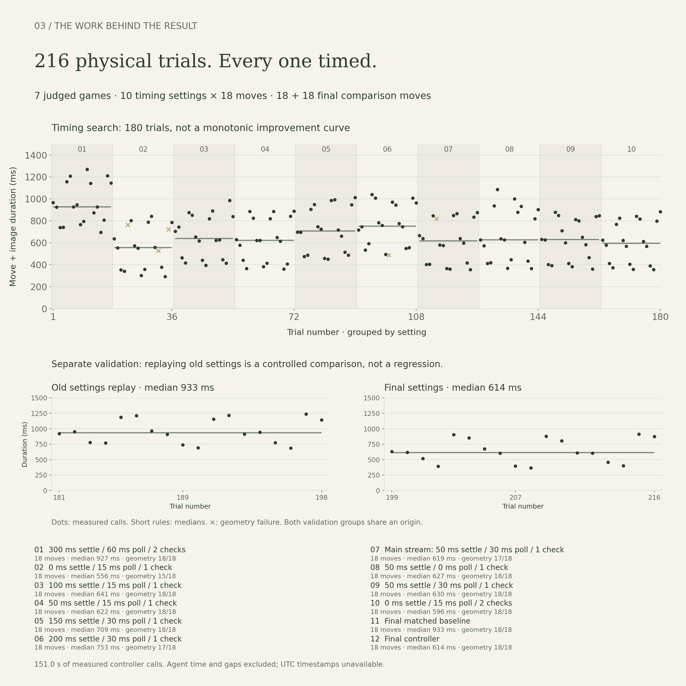
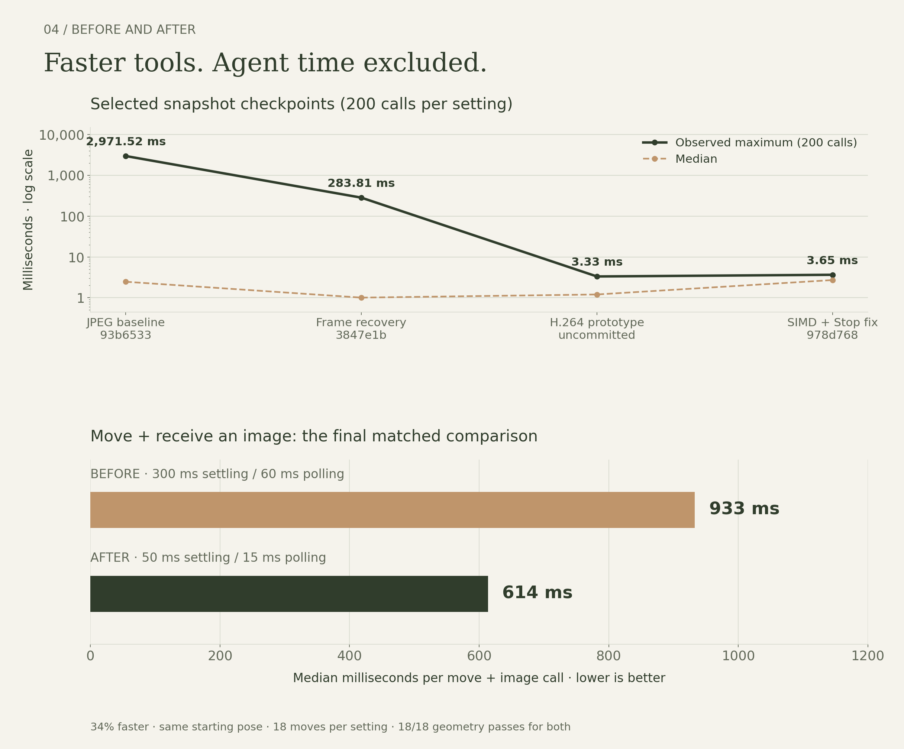

# Peek, Seek, and recursive self-improvement

*Two cheap cameras, a game of I spy, and an agent rewriting the tools it uses to see.*

I asked a coding agent to find the printer in my office. It found it, slowly:
snapshot, move, wait, correct. Because it could edit its camera runtime, every
awkward interaction became a candidate improvement.

The cameras are **Peek and Seek**, two Tapos costing about $25 each. Peek sets
the challenge; Seek searches. Adding googly eyes made AI-controlled cameras
looking around the room feel considerably less off-putting to me.

## Turn the task into the test

We made I spy a **recursive self-improvement (RSI) loop**. An independent agent
behind Peek chose an object and withheld its coordinates. Seek's operator
searched; the challenger judged recognition, centering, and motion smear.
Timing traces identified bottlenecks, and the operator rewrote its own tools
before playing again.

Fresh targets checked usefulness. Repeated same-origin movements separated
runtime improvements from learning where the printer lived.

The archive contains **216 timed motion trials**: ten settings tested over
18 moves each, then an 18-versus-18 final comparison. The game provided
**seven independent evaluations**. These counts describe experimental coverage,
not 216 successive code improvements.

[Inspect every trial and its timing](assets/motion-trials.html) ·
[Download all 216 timings](assets/motion-trials.csv)

*Each dot is a measured move-plus-image call. The sequence preserves order within
each archived batch; absolute UTC timestamps were not stored. Agent time, gaps,
restores, and delayed image evaluation are excluded.*

## Improve the eyes, then the control loop

Reopening RTSP for each snapshot cost about **2.5 seconds**. We built a Rust
runtime with persistent H.264 ingestion, accelerated codecs, and a latest-frame
buffer. Warm previews reached approximately **2 ms**. This compared capture
architectures, rather than isolating language speed.

One image-point centering call absorbed calibrated ONVIF movement and bounded
visual corrections. Batched scans removed reasoning round trips. Faster variants
still had to pass: maximum-speed commands stalled, continuous motion overshot,
and zero-wait settings blurred images or broke scan revisits.

Most gains came early: the stream architecture changed first, then conservative
motion waits were shortened. The remaining trials explored a plateau and caught
quality regressions. The motion study already used Rust and H.264, so it does not
show the earlier architectural gain.

The final check cut median **movement-plus-image latency from 933 to 614 ms
(34%)**, with 18/18 optical geometry passes in each block. Replaying the old
settings established that comparison; it was not a backwards step in progress.

*Summary only: four selected snapshot checkpoints above, and the final matched
motion comparison below. These are not loop counts. Both motion settings require
two arrival reports; settling is an extra pause, and polling is the position-query
interval. The matched blocks ran baseline first.*

An improvement survived only if independent challenges and replayed measurements
supported it. That external feedback closed the RSI loop.

Inspect the video and control pipeline

[Full-size chart](assets/latency-history.svg) ·
[Measurements and rejected experiments](../../benchmarks/i-spy/README.md) ·
[Chart data](assets/latency-history.csv) ·
[Chart provenance](assets/latency-history.json) ·
[Source code](https://github.com/Belval/onvif-mcp)
