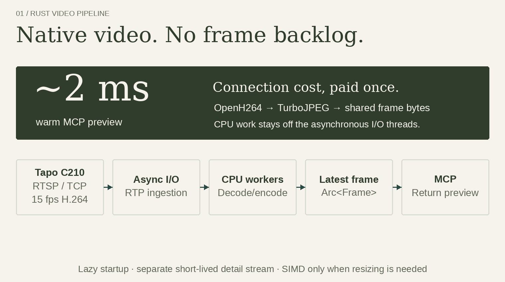
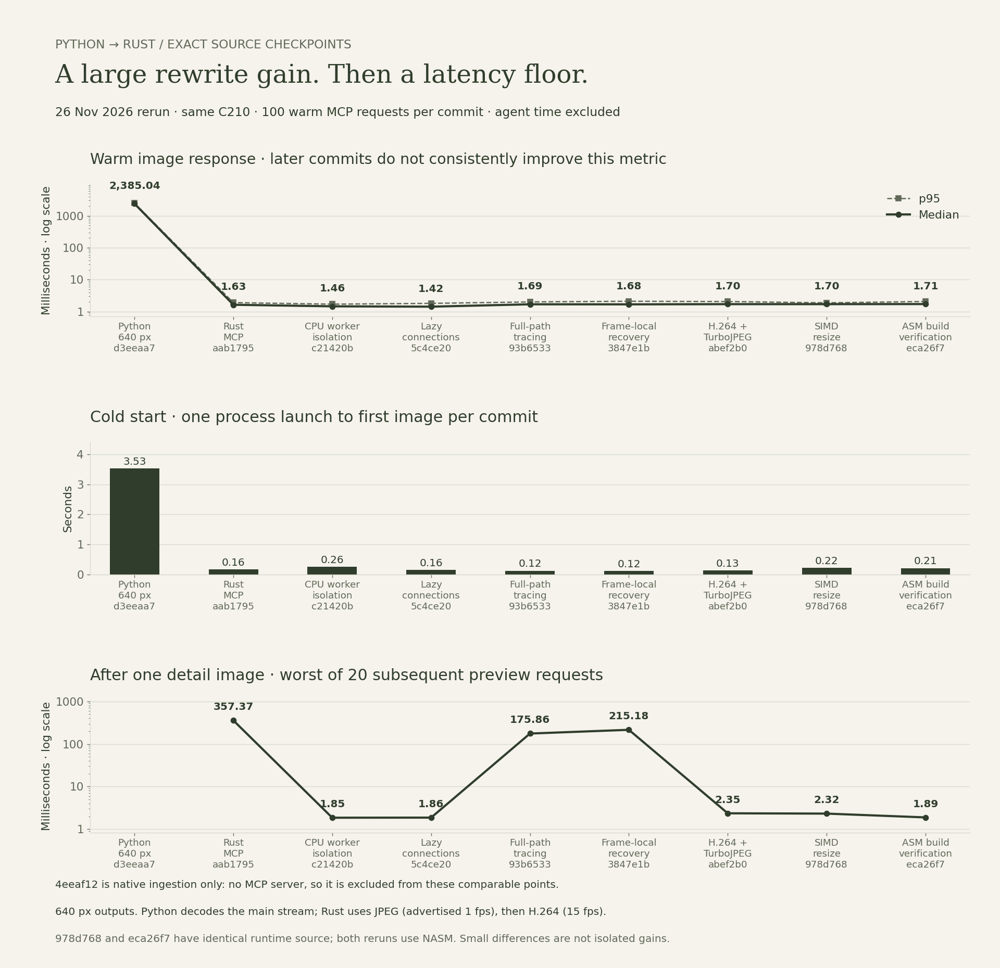

# Peek, Seek, and recursive self-improvement

*From a Python ONVIF reader to a native Rust camera pipeline, guided by a game of I spy.*

I asked a coding agent to find the printer in my office. It found it, slowly:
snapshot, move, wait, correct. The agent could edit its camera tools, so each
awkward interaction was also evidence for what to improve.

Meet **Peek and Seek**, two roughly $25 Tapos. Peek's agent chooses an object and
withholds its coordinates; Seek's agent searches. The googly eyes made the whole
business of AI-controlled cameras looking around my room feel less off-putting.

## Rewrite the architecture, then optimize the runtime

The Python path reopened RTSP for every snapshot, costing about **2.5 seconds**.
We moved ONVIF, video ingestion, MCP and tracking into Rust. A persistent stream
published only the newest frame, shared through `Arc`, instead of reopening the
connection or accumulating an image queue. Warm previews reached approximately
**2 ms**. The camera still supplies 15 fps; this is buffered retrieval time.
The architecture changed along with the language.

Then we worked on the Rust pipeline: keep codec work off Tokio's I/O workers,
avoid leaving detail streams running, and open connections only when used.
Tracing exposed reconnect stalls. Frame-local JPEG recovery helped, and switching
the preview to H.264 removed the observed multi-second capture stalls.

The image path gained a reusable TurboJPEG compressor and SIMD resizing. One
particularly useful discovery: installing NASM had not accelerated a previously
cached OpenH264 build. We cleaned and rebuilt that release dependency, then
verified the assembly symbols in the resulting archive.

## A large rewrite gain, then a latency floor

We rebuilt **all ten source commits** on 26 November, then ran 100 stationary
preview requests per complete MCP implementation on the same C210. These are
fresh reruns, not reconstructed October timings. The camera now runs firmware
1.2.7; the original archive used 1.1.1. Agent time is excluded.

The initial rewrite moved the median from **2,385 ms to 1.63 ms**. The fastest
later checkpoint reached **1.42 ms**; the final one measured **1.71 ms**, about
**21% higher**. These measurements do **not** demonstrate continuous improvement
in cached-response latency.

The later work addressed other costs. Isolating codec work reduced the worst of
20 post-detail previews from **357 ms to 1.85 ms** in this run. Stalls still
appeared in subsequent JPEG runs; after switching to H.264, the observed worst
warm request was **2.50 ms**, and the worst post-detail preview was **2.35 ms**.
Those are sampled observations, not guaranteed bounds.

Tracing also costs time. A separate control held the final binary and camera
settings fixed across six alternating on/off blocks of 100 requests. With
tracing, block medians were **1.80–1.81 ms**; without, **1.67–1.68 ms**. That
establishes overhead in this control, not an explanation for the entire
cross-commit increase. [Tracing control data](https://github.com/Belval/onvif-mcp/blob/main/benchmarks/commit-history/tracing-control-2026-11-26.json)

A cached response does not measure the whole vision pipeline. Python opens the
main stream and downsizes it; Rust maintains preview streams and returns the
latest buffered image. H.264 adds a configured 15 fps preview source. This test
skips resizing at 640 px, so it cannot establish SIMD's benefit. All fresh builds
use NASM, so it cannot recover the original assembly-build speedup either.
The ten commits document engineering iterations; they are not ten demonstrated
latency wins.

Read every commit's timings and measurement boundaries

All values below are milliseconds. Warm median, p95 and maximum use 100 requests;
post-detail maximum uses a separate 20 requests. Cold time includes process
launch, initialization, discovery and the first complete image response.

| Commit / change | Cold | Warm median | p95 | Warm max | Post-detail max |
| --- | ---: | ---: | ---: | ---: | ---: |
| [d3eeaa7](https://github.com/Belval/onvif-mcp/commit/d3eeaa7d4cbc5e0edad00b7fed87ee31ad1352e8) · Smaller Python previews | 3,532.67 | 2,385.04 | 2,482.65 | 2,586.20 | — |
| [4eeaf12](https://github.com/Belval/onvif-mcp/commit/4eeaf12cdf52e195d7a993288b3d37cbb6ae0b41) · Native Rust ingestion | Native only¹ | — | — | — | — |
| [aab1795](https://github.com/Belval/onvif-mcp/commit/aab1795007f4cda627f2aea488016039f08455e5) · Complete the Rust tool path | 160.44 | 1.63 | 1.90 | 2.33 | 357.37 |
| [c21420b](https://github.com/Belval/onvif-mcp/commit/c21420b48dca1022d7e2597e64b07331add04030) · Keep I/O nonblocking | 258.96 | 1.46 | 1.70 | 277.47 | 1.85 |
| [5c4ce20](https://github.com/Belval/onvif-mcp/commit/5c4ce20ce3979367c26c8514d578b06bba7c3058) · Connect only on demand | 155.43 | 1.42 | 1.80 | 2.01 | 1.86 |
| [93b6533](https://github.com/Belval/onvif-mcp/commit/93b653364a677cfe009c92443dffc6742e81675b) · Instrument the whole path | 123.90 | 1.69 | 2.00 | 2.54 | 175.86 |
| [3847e1b](https://github.com/Belval/onvif-mcp/commit/3847e1b6db35b02eb35442ac490ec34eae82abdf) · Recover frames locally | 120.31 | 1.68 | 2.10 | 195.81 | 215.18 |
| [abef2b0](https://github.com/Belval/onvif-mcp/commit/abef2b09b583006d340796c16fb7a1d3ea092e96) · Change the preview source + Reuse encoding state | 127.75 | 1.70 | 2.06 | 2.50 | 2.35 |
| [978d768](https://github.com/Belval/onvif-mcp/commit/978d7687cbf0636fc7d0757c5ea47cb1f54d1604) · SIMD image processing | 221.41 | 1.70 | 1.88 | 2.34 | 2.32 |
| [eca26f7](https://github.com/Belval/onvif-mcp/commit/eca26f7a2efa60fc14a663eadadb3e7c40561238) · Verify accelerated builds | 210.52 | 1.71 | 2.06 | 2.33 | 1.89 |

¹ `4eeaf12` has no MCP server. Its native video acquisition took **256 ms** and
five printed buffer reads each took **0.001 ms**; these have a different boundary
and are excluded from the chart. H.264 and encoder reuse share `abef2b0`, giving
eleven checkpoints across ten commits. `eca26f7` changes build evidence only;
both final builds use NASM, so their small differences are run-to-run variation.

Each commit has one sequential measurement block. An observed maximum is not a
guarantee, and these runs do not establish tiny isolated effects. The raw data
also retains phase timings, producer metrics, binary hashes and every request.

[Download the timing table](assets/commit-history.csv) ·
[Protocol and reproducible harness](https://github.com/Belval/onvif-mcp/tree/main/benchmarks/commit-history) ·
[Raw per-request results](https://github.com/Belval/onvif-mcp/blob/main/benchmarks/commit-history/results-2026-11-26.json)

## Close the RSI loop with external feedback

I spy supplied the task; timing traces identified bottlenecks; the agent rewrote
its tools; independent images and replayed measurements tested the result. That
was our **recursive self-improvement loop**, operating on the agent's tooling.

The archive contains **7 independently judged games and 216 timed motion trials**.
Most gains came early. Later tests explored a performance floor and rejected
faster settings that blurred images or broke revisits. Those trials establish
coverage and reliability, not 216 successive code improvements.

Inspect the RSI loop and all 216 motion timings

<a href="assets/motion-trials.html">Inspect every trial interactively</a> · <a href="assets/motion-trials.csv">Download 216 exact timings</a>

Selected latency measurements and final motion comparison

These four snapshot benchmarks are selected measurement windows, not a count of improvements. The motion study already used Rust and H.264. Its final same-origin comparison was 933 → 614 ms median, with 18/18 geometry passes in both blocks. Agent time is excluded.

[Source code](https://github.com/Belval/onvif-mcp) ·
[Benchmark evidence](../../benchmarks/i-spy/README.md) ·
[Engineering checkpoint sources](assets/software-checkpoints.json)
